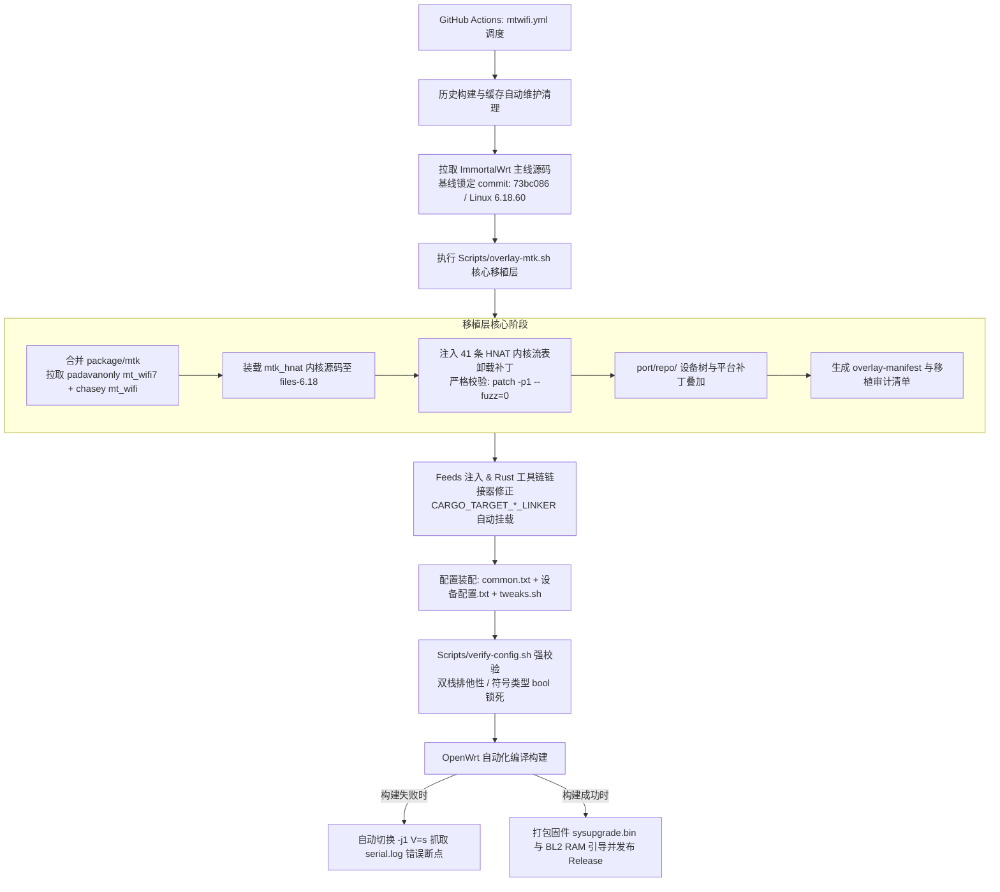

<div align="center">

# MTWIFI-CI

**ImmortalWrt 主线快照（Linux 6.18）× 联发科 MTK 闭源无线驱动与 HNAT 硬件加速移植层**

<p align="center">
  <a href="https://github.com/LianXia233/MTWIFI-CI/actions/workflows/mtwifi.yml">
    
  </a>
  <a href="https://github.com/LianXia233/MTWIFI-CI/releases">
    
  </a>
  <a href="https://github.com/immortalwrt/immortalwrt">
    
  </a>
  <a href="https://kernel.org">
    
  </a>
</p>

<p align="center">
  <a href="#支持设备与配置矩阵">
    
  </a>
  <a href="#支持设备与配置矩阵">
    
  </a>
  <a href="#支持设备与配置矩阵">
    
  </a>
  <a href="LICENSE">
    
  </a>
</p>

<p align="center">
  <a href="#-项目概览">项目概览</a> •
  <a href="#-支持设备与配置矩阵">设备矩阵</a> •
  <a href="#-流水线架构与移植机制">流水线架构</a> •
  <a href="#-618-移植现状与断点收敛">移植现状</a> •
  <a href="#-快速上手">快速上手</a> •
  <a href="#-预置插件与自研生态">预置生态</a> •
  <a href="#-鸣谢与致敬">致敬</a>
</p>

---

</div>

> [!NOTE]
> **移植进展更新（按实际 CI 构建验证）**
>
> - **CI 构建与固件发布已全线打通**：`H5000M-MT7-MT5700` 与 `AP3000M-MT` 矩阵目标均已通过 GitHub Actions 自动化编译，并生成正式的 `sysupgrade.bin` 固件镜像与 BL2 引导；
> - **6.18 内核补丁全量闭环**：HNAT 全系列 41 条补丁在 6.18.55 实树上以 `--fuzz=0` 逐条精准命中，17 个关键内核对象经交叉工具链编译零报错验证；
> - **双栈互斥彻底隔离**：显式移除主线开源 mt76 家族，由闭源 `mt_wifi` / `mt_wifi7` 纯净接管无线，驱动与 `mtkhnat`、`warp`、`mtk_wed` 深度咬合；
> - 固件仅用于移植调试，刷入前请务必备份原厂/官方出厂分区（特别是 Factory / EEPROM）。

> [!WARNING]
> **编译通过 ≠ 实机可用。当前固件尚未跑通实机验证，请勿作为日常固件使用。**
>
> - CI 只证明「源码能编译、包能组装、镜像能生成」，不等于设备能正常启动，也不等于无线、HNAT/WED、蜂窝模组等功能可用；
> - **AP3000M**：6.18.60 实机串口日志已确认启动阶段 `conninfra` 崩溃（`mcu clock not found` 后把 `ERR_PTR` 传给 `clk_prepare`，触发 Oops → panic）。已加入 `port/conninfra-patches/011-fix-clk-errptr.patch`，但**尚未重新烧录复验**；
> - **H5000M**：尚未完成实机启动、WiFi7 建链、HNAT/WED 转发、MT5700 模组等任何上机验证；
> - 上述问题修复并复验前，Release 产物仅作移植过程留档；刷机风险自负。

---

## 主线 mt76 替代路线

仓库的 [`mainline/`](mainline/) 目录提供一条与现有闭源 overlay 独立的构建路线：固定 ImmortalWrt `73bc086a62f951d96e5d7404f04c4d73e141cad2`（Linux 6.18.60）与 mt76 `0936617dc529ff9da0385221d3fa6de732231177`，只叠加自写的 MT7992 TX-only WED 补丁、设备配置、模块参数和验收脚本。

| 设备 | 无线驱动 | 硬件加速边界 |
|:---|:---|:---|
| Hiveton H5000M | 主线 `mt7996e` + MT7992 variant 23 固件 | TX WED/AMSDU 与 PPE 流表；MT7987 缺少 WO 固件和设备树资源，WiFi RX 保留 CPU |
| AirPi AP3000M | 主线 `mt7915e` + MT7981/WO 固件 | 主线 WED/WO，包含 WiFi RX RRO；需实机计数器验收 |
| USB 网络设备 | 主线 RTL8152、CDC-NCM/CDC-Ether、QMI-WWAN | 热插拔时开启设备实际支持的 checksum/TSO/GSO/GRO；当前主线 PPE 没有 USB 网卡零 CPU NAT 路径 |

该目录**不是从零逐行重写驱动**。它使用独立的 [`mainline-mt76.yml`](.github/workflows/mainline-mt76.yml)，现有闭源 `mtwifi.yml` 保持不变。本地静态校验、两台设备 defconfig、H5000M mt76 与 USB 模块/APK 编译已通过；两台完整镜像和实机 WED/PPE/USB 验证仍需以实际构建结果为准。

```sh
cd mainline
sh scripts/build.sh --source /path/to/immortalwrt --device h5000m --jobs 12 --overwrite-config
sh scripts/build.sh --source /path/to/immortalwrt --device ap3000m --jobs 12 --overwrite-config
```

GitHub Actions 可手动触发两台设备：

```sh
gh workflow run mainline-mt76.yml --ref main -f device=all
```

Windows 使用 Git Bash 执行同一命令，`--source` 可传 `/home/...` 或 `//wsl.localhost/<发行版>/home/...`，脚本会重执行到 WSL。构建前请保存源树中的本地 `.config`。

---

## 📖 项目概览

**MTWIFI-CI** 是一个面向联发科 Filogic 生态的现代化固件云编译与移植工程。

本项目立足于 **ImmortalWrt 主线快照**（基线锁定 `73bc086a62f9`，Linux 内核 **6.18.60**，LuCI Master 最新前端），通过自研的自动化 **Overlay 移植层** 与细粒度补丁适配体系，将原本仅在 6.6 / 6.12 等旧版 SDK 中存活的 **MTK 闭源无线驱动栈（mtwifi / mt_wifi7）** 与 **全套硬件加速（mtk_hnat + WED/WARP 无线硬件卸载）** 移植至 6.18 现代化内核，让老牌强劲的闭源驱动重焕生机。

### 🌟 核心特色

- ⚡ **真正的硬件加速（HNAT + WED/WARP）**：告别纯软转发，充分激活 MediaTek PPE（Packet Processing Engine）硬件流表加速，实现千兆/2.5G 跑满 CPU 几乎零负载。
- 📶 **独占式闭源无线驱动**：
  - **H5000M**：搭载全新 **mt_wifi7 (v7.9x)**，原生 Wi-Fi 7 / BE6500 支持，双频高吞吐量与极低抖动；
  - **AP3000M**：集成稳定成熟的 **mt_wifi (v7.6.7.3)**，AX3000 完整频宽与专属 IPA/ILNA 参数支持。
- 📱 **深度蜂窝模组（4G/5G）加速与自研前端**：
  - H5000M 整合自研的 [luci-app-mt5700](https://github.com/LianXia233/luci-app-mt5700)（Rust + Tokio 异步后端，支持原生 USB 蜂窝加速）；
  - AP3000M 整合自研的 [luci-app-fm350](https://github.com/LianXia233/luci-app-fm350)（FM350-GL 专属 Rust 守护程序 `fm350d`，独占 AT 串口调度）。
- 🛡️ **生产级 CI 校验拦截**：内置 `verify-config.sh` 和 `verify-port.sh`，在编译前精准拦截驱动栈冲突、模块缺失、Kconfig 类型异常等，杜绝空镜像与隐藏暗病。

---

## 🚀 支持设备与配置矩阵

| 特性 / 规格 | 旗舰 Wi-Fi 7：Hiveton H5000M | 高性价比 Wi-Fi 6：AirPi AP3000M |
|:---|:---|:---|
| **构建目标代号** | `H5000M-MT7-MT5700` | `AP3000M-MT` |
| **主控芯片 (SoC)** | **MediaTek MT7987A**（Filogic 860，四核 A53 @ 2.0GHz） | **MediaTek MT7981B**（Filogic 820，双核 A53 @ 1.3GHz） |
| **射频方案 (WiFi)** | **MediaTek MT7992**（BE6500，Wi-Fi 7 双频） | **MediaTek MT7976C / DBDC**（AX3000，Wi-Fi 6 双频） |
| **射频前端 (FEM)** | 第一频 IPA+ILNA / 第二频 IPA+ILNA | 内部集成射频功率放大（IPA+ILNA） |
| **闭源驱动版本** | **`mt_wifi7`**（7.9x 统一命令接口体系） | **`mt_wifi`**（7.6.7.3 经典稳定栈） |
| **硬件加速架构** | `mtk_hnat` (V5 布局) + WED + WARP v3.1 | `mtk_hnat` (V4 布局) + WARP v2 |
| **蜂窝网络扩展** | MT5700M 5G 模组（USB） | 广和通 FM350-GL 5G 模组（USB） |
| **模组管理套件** | [luci-app-mt5700](https://github.com/LianXia233/luci-app-mt5700)（Rust 常驻守护） | [luci-app-fm350](https://github.com/LianXia233/luci-app-fm350)（Rust `fm350d` 守护） |
| **板载温控与风扇** | `luci-app-h5000m-fancontrol` + PWM 风扇调速 | `luci-app-airpi3000m-fancontrol` + 智能温控策略 |
| **网络模式调度** | `luci-app-h5000m-netmode`（多链路智能切换） | 链路聚合 / 策略分流 |
| **EEPROM / 校准** | 原厂 Flash 偏移注入（`0xc0000` / `0xc8000`） | Hotplug 首启守卫自动校验并生成 Factory 模板 |
| **网络延迟看板** | 集成自研 `luci-app-netmonitor`（微秒级链路监控） | 集成自研 `luci-app-netmonitor` |
| **UI 主题与交互** | `luci-theme-vantage`（微米级进度条样式重绘） | `luci-theme-vantage` |

---

## 🛠️ 流水线架构与移植机制

MTWIFI-CI 采用高度解耦的分层构建流水线，核心逻辑在 [`Scripts/overlay-mtk.sh`](Scripts/overlay-mtk.sh) 与各级守卫脚本中实现：



### 闭源依赖输入源

| 驱动 / 模块包 | 上游数据源 | 关键组件与用途 |
|:---|:---|:---|
| **Wi-Fi 7 系列** | [padavanonly/immortalwrt-mt798x-6.6](https://github.com/padavanonly/immortalwrt-mt798x-6.6) | `mt_wifi7`, `mt_wifi_cmn`, `mt_hwifi`, `conninfra`, `warp`, `wifi-profile`, `datconf`, `mtwifi-cfg`, `turboacc-mtk` |
| **旧版 Wi-Fi 6 栈** | [chasey-dev/immortalwrt-mt798x-rebase](https://github.com/chasey-dev/immortalwrt-mt798x-rebase) | `mt_wifi` (7.6.7.3), `mtk_hnat` 核心驱动源码, HNAT 内核流表补丁系列 |
| **自研生态与工具** | [LianXia233](https://github.com/LianXia233) | `luci-app-mt5700`, `luci-app-fm350`, `fancontrol` 系列, `netmonitor`, `taygedo` 预编译加载器 |

---

## 🔬 6.18 移植现状与断点收敛

从 Linux 6.6 / 6.12 跨代迁徙至 6.18 LTS，内核底层对网络、驱动总线与中断接口进行了大刀阔斧的重构。本项目已攻克的关键技术卡点如下：

- [x] **NETSYS 代际宏 bool 强制锁定**：`CONFIG_MEDIATEK_NETSYS_V2/V3` 被声明为 `bool`，根治了在上游设为 `tristate` 时在模块编译模式下退化为 `_MODULE` 宏进而导致寄存器偏移回退至 V1 致命 Bug；
- [x] **WEXT 兼容层重塑**：6.18 内核默认移除了 `WIRELESS_EXT`，通过补齐内核 Kconfig 描述并强制开启 `CONFIG_WIRELESS_EXT=y` 与 `CONFIG_WEXT_PRIV=y`，保障闭源 `mtwifi-cfg` 和私有 ioctl 调用面；
- [x] **无线子系统解耦验证**：经 `nm -u` 符号逆向审计证实，闭源 `mt_wifi` / `mt_wifi7` **零依赖** `cfg80211/mac80211`，规避了内核无线子系统剧烈变动带来的隐患，接口收敛在标准 Netdev 与 DMA/PCI 面；
- [x] **Musl Rust 交叉链接断点修复**：在 CI 构建流中自动探测 AArch64 目标架构并注入 `CARGO_TARGET_<TRIPLE>_LINKER="$(TARGET_CC_NOCACHE)"`，杜绝 host ld 误读 Cortex-A53 专用链接参数；
- [x] **Taygedo 自动签到轻量化集成**：预取官方编译好的 `aarch64-unknown-linux-musl` 预编译二进制，无需在 OpenWrt 内部重编译庞大 Rust 生态，兼顾速度与产物体积。

> 深度适配规范、补丁打法以及未闭环的观测点详见 [port/README.md](port/README.md) 与 [docs/01-driver-analysis.md](docs/01-driver-analysis.md)。

---

## ⚡ 快速上手

### 1. 固件开箱默认信息

刷入固件后，设备出厂默认参数如下：

| 参数项 | 默认配置 |
|:---|:---|
| **后台管理地址** | `http://192.168.10.1` |
| **默认管理员** | `root` |
| **默认密码** | **无密码**（首次登录后请立即前往系统设置密码） |
| **默认 Wi-Fi SSID** | `OWRT` |
| **默认 Wi-Fi 密码** | `12345678` |
| **默认系统时区** | Asia/Shanghai（北京时间 UTC+8） |
| **默认后台主题** | Vantage（已预装 Aurora、Argon 备选） |

### 2. 获取预编译固件

直接前往仓库的 [Releases 页面](https://github.com/LianXia233/MTWIFI-CI/releases) 下载最新产物：
- `*-sysupgrade.bin`：适用于已有 OpenWrt / ImmortalWrt 系统的常规后台升级；
- `*.bin` (BL2/RAM Loader)：用于救砖恢复或原厂 Bootloader 引导启动。

### 3. 云编译自定义工作流

如果你想微调编译选项、增删专属插件或追踪更新：

1. **Fork 本仓库** 到自己的 GitHub 账号下；
2. 进入仓库 **Settings → Actions → General → Workflow permissions**，勾选 **Read and write permissions** 并保存；
3. 点击 **Actions → mtwifi → Run workflow**，在弹出的窗口中按需输入参数：
   - **`pin`**：留空即使用内置固定快照 commit；也可填入指定的 ImmortalWrt commit 哈希；
   - **`packages`**：临时添加软件包，例如 `CONFIG_PACKAGE_luci-app-openclash=y`；
   - **`test`**：勾选时仅合成 `.config` 并验证配置，不启动编译，用于秒速调试依赖关系。

---

## 📦 预置插件与自研生态

固件坚持“精选实用、绝不臃肿”的理念，内置了丰富的常用网络与硬件扩展功能：

### 📱 5G 模组与硬件协同
- **MT5700 套件 (H5000M)**：集成 `luci-app-mt5700`、`luci-app-h5000m-fancontrol`、`luci-app-h5000m-netmode`
- **FM350 套件 (AP3000M)**：集成 `luci-app-fm350`、`luci-app-airpi3000m-fancontrol`
- **底层驱动全家桶**：内置 `kmod-usb-net-cdc-ncm`、`kmod-usb-net-rndis`、`kmod-usb-net-qmi-wwan`、`sms-tool`

### 🚀 网络加速与科学工具
- **硬件级加速**：`luci-app-turboacc-mtk`、`luci-app-eqos-mtk`（闭源流量调度）
- **加密与硬件引擎**：`kmod-crypto-hw-safexcel`（EIP97 / EIP197 硬件加解密加速）
- **科学出国生态**：精选 `OpenClash`、`PassWall2`、`Nikki (mihomo-alpha)`
- **组网神器**：`luci-app-easytier`（新一代分布式异地组网工具）

### 📊 系统运维与日常管理
- **自研微秒监控**：`luci-app-netmonitor` 实时展示全网链路状况与时延图谱
- **每日自动签到**：`luci-app-taygedo`（幻塔/异环每日签到自动化）
- **磁盘管理与共享**：`luci-app-mini-diskmanager`、`luci-app-chfs`（CuteHttpFileServer）
- **精美视觉主题**：`luci-theme-vantage`、`luci-theme-aurora`、`luci-theme-argon`

---

## 🤝 鸣谢与致敬

本工程的诞生与迭代离不开开源社区与驱动探索先驱们的杰出贡献，在此致以崇高敬意：

- **驱动与底层生态**：
  - [padavanonly (237)](https://github.com/padavanonly) —— 提供优质的 mt798x 6.6/WiFi 7 闭源移植工程与组件；
  - [hanwckf](https://github.com/hanwckf) —— MTK 闭源驱动生态的拓荒者；
  - [chasey-dev](https://github.com/chasey-dev) —— 卓越的 mt798x rebase 与 HNAT 补丁拆解整理；
  - **MediaTek SDK Team** —— 硬件底层平台支持。
- **流水线架构与引导**：
  - [VIKINGYFY/CloseWRT-CI](https://github.com/VIKINGYFY/CloseWRT-CI) —— 借鉴其优异的构建流程设计思想；
  - [P3TERX/Actions-OpenWrt](https://github.com/P3TERX/Actions-OpenWrt) —— 经典的 Actions 模板启发。
- **上游基座**：
  - [ImmortalWrt](https://github.com/immortalwrt/immortalwrt) & [OpenWrt](https://github.com/openwrt/openwrt)

---

## 📄 License

本项目采用 [MIT License](LICENSE) 授权开源。所调用的 MTK 驱动与闭源二进制组件版权归原作者及联发科技（MediaTek Inc.）所有。
